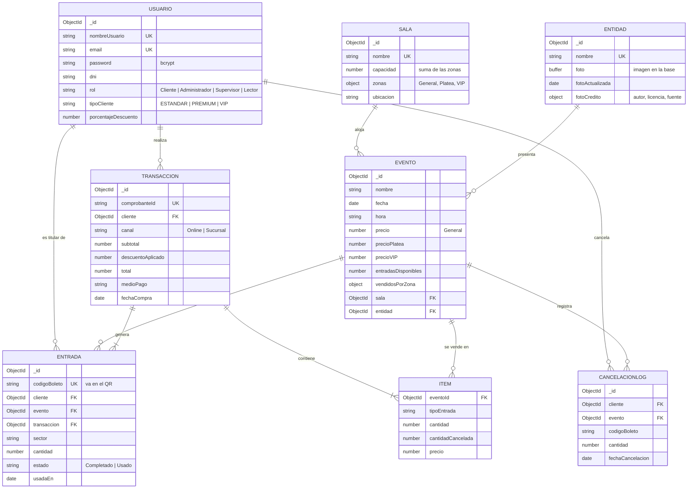

# 🎭 Urbana Cult · Sistema de venta de entradas

> Desarrollado por **Sintaxia**.

**Urbana Cult** es una aplicación web para la gestión y venta de entradas de eventos culturales: salas con sectores (General, Platea y VIP), eventos, artistas, carrito de compras con pago simulado, boletería física, membresías con descuento, cancelaciones e informes de ventas, con control de acceso por roles.

Está desarrollada con **Node.js**, **Express 5**, **MongoDB (Mongoose)** y vistas **Pug**, siguiendo el patrón **MVC**.

---

## 📋 Requisitos

- [Node.js](https://nodejs.org/) **18 o superior** (incluye npm).
- Una base de datos **MongoDB**:
  - **MongoDB Atlas** (en la nube), o
  - **MongoDB local** (Community Server) escuchando en `127.0.0.1:27017`.

Si la conexión a Atlas falla o no está configurada, la aplicación se conecta automáticamente a la base local.

---

## 🚀 Instalación y puesta en marcha

1. **Clonar el repositorio**

   ```bash
   git clone https://github.com/brianlavandera1/tp2.git
   cd tp2
   ```

2. **Instalar las dependencias**

   ```bash
   npm install
   ```

3. **Configurar las variables de entorno**

   Copiar el archivo de ejemplo y completar los valores:

   ```bash
   cp .env.example .env
   ```

   | Variable | Obligatoria | Descripción |
   |---|---|---|
   | `PORT` | No | Puerto del servidor (por defecto `3000`). |
   | `MONGODB_URI` | No | Cadena de conexión de MongoDB Atlas. |
   | `MONGODB_URI_LOCAL` | No | Base local usada si Atlas no está disponible (por defecto `mongodb://127.0.0.1:27017/TP2`). |
   | `SESSION_SECRET` | **Sí** | Clave para firmar la cookie de sesión. Debe ser larga y aleatoria. |
   | `SESSION_MAX_AGE_HORAS` | No | Duración de la sesión en horas (por defecto `8`). |
   | `NODE_ENV` | No | `development` o `production`. En `production` la cookie de sesión solo viaja por HTTPS. |

   Para generar un `SESSION_SECRET`:

   ```bash
   node -e "console.log(require('crypto').randomBytes(32).toString('hex'))"
   ```

   > ⚠️ El archivo `.env` contiene credenciales: está en `.gitignore` y **nunca** debe subirse al repositorio.

4. **Cargar datos de prueba** (opcional, recomendado la primera vez)

   ```bash
   npm run seed
   ```

   > ⚠️ El seed **borra** usuarios, artistas, salas, eventos, entradas y transacciones de la base configurada antes de cargar los datos de ejemplo. No ejecutarlo sobre una base con datos reales.

   El seed carga 6 usuarios, 10 artistas (todos con foto), 3 salas y 11 funciones. Las funciones son **ficticias**: existen solo como datos de demostración del proyecto.

5. **Iniciar el servidor**

   ```bash
   npm run dev     # desarrollo, se reinicia solo al guardar cambios (nodemon)
   npm start       # producción
   ```

   Abrir [http://localhost:3000](http://localhost:3000).

---

## 👤 Usuarios de prueba (creados por el seed)

Todos usan la contraseña `123` y se puede entrar con el nombre de usuario o con el email.

| Usuario | Email | Rol |
|---|---|---|
| `admin` | admin@email.com | Administrador |
| `supervisor` | supervisor@email.com | Supervisor |
| `lector` | lector@email.com | Lector |
| `cliente1` | juan.perez@email.com | Cliente con membresía VIP (30 % de descuento) |
| `cliente3` | pedro.ruiz@email.com | Cliente con membresía Premium (15 % de descuento) |
| `cliente2` | maria.gomez@email.com | Cliente con membresía Estándar (sin descuento) |

Se pueden crear más usuarios de personal desde el panel del administrador, en **Usuarios → Crear personal**.

---

## 🔐 Roles y permisos

| Funcionalidad | Cliente | Lector | Supervisor | Administrador |
|---|:-:|:-:|:-:|:-:|
| Ver cartelera, comprar, cancelar entradas propias, membresía y perfil | ✅ | | | |
| Ver panel, usuarios, pagos, cancelaciones e informes | | ✅ | ✅ | ✅ |
| Ver salas, eventos y artistas | | ✅ | ✅ | ✅ |
| Crear, editar y eliminar salas, eventos y artistas | | | ✅ | ✅ |
| Boletería física (venta en sucursal) | | | ✅ | ✅ |
| Validar entradas en la puerta (QR) | | | ✅ | ✅ |
| Crear, editar y eliminar usuarios y personal | | | | ✅ |
| API `/entradas`: alta, modificación y baja | | | | ✅ |

La autenticación usa **sesiones** (`express-session`) guardadas en **MongoDB** (`connect-mongo`), con contraseñas encriptadas con **bcrypt**. La autorización se resuelve con los middlewares `verificarAutenticacion` y `verificarRol(roles)`.

### 🛡️ Seguridad

- **Encabezados HTTP seguros** con `helmet`: política de contenido (CSP) que solo permite recursos del propio sitio, protección contra *clickjacking* (`frame-ancestors 'none'`) y `X-Content-Type-Options: nosniff`.
- **Límite de intentos de login** (middleware propio `limiteLogin`): después de 5 intentos fallidos en 15 minutos para la misma IP y usuario, se bloquea temporalmente (HTTP 429).
- **Sesiones persistentes en MongoDB**: sobreviven a reinicios del servidor y MongoDB borra solas las vencidas. Al iniciar sesión se genera un id nuevo (previene la fijación de sesión) y al salir se borra la sesión y la cookie.
- **Cookie de sesión** `httpOnly`, `sameSite=lax` y `secure` en producción.
- **Validación en el servidor** de todos los formularios y de los archivos subidos (tipo real de imagen por sus primeros bytes y tamaño máximo).

---

## ✨ Funcionalidades

- **Autenticación:** registro de clientes con validaciones, login por nombre de usuario o email y redirección según el rol.
- **Salas:** CRUD con capacidad por sector (General, Platea y VIP).
- **Eventos:** CRUD asociado a una sala y a un artista o compañía, con precio por sector y control de cupo según la capacidad de la sala.
- **Artistas / entidades:** alta rápida desde el formulario de eventos o desde su propia sección, con **foto opcional** (JPG, PNG o WEBP de hasta 2 MB) que se puede cambiar o quitar.
- **Cartelera:** búsqueda por texto (nombre, descripción o artista) y filtro por fecha. Cuando el artista tiene foto, la tarjeta del evento la usa de fondo con efecto duotono (a todo color al pasar el mouse), y la portada muestra al artista destacado.
- **Carrito y pago simulado:** validación de stock por sector, descuento según la membresía, validación de tarjeta en el servidor y comprobante de compra.
- **Reserva atómica de cupos:** dos compras simultáneas no pueden sobrevender un sector.
- **Transacciones de MongoDB:** la compra (reserva de cupos, entradas y pago), la venta en boletería y la cancelación se guardan completas o no se guardan. En Atlas se usan transacciones nativas; con un MongoDB local *standalone* (que no las admite) se revierten los pasos automáticamente si algo falla (`utils/transaccion.js`).
- **Membresías:** Estándar (0 %), Premium (15 %) y VIP (30 %) de descuento.
- **Mis compras y cancelaciones:** el cliente cancela sus entradas, el cupo vuelve al evento y la cancelación queda registrada para auditoría.
- **Entradas con código QR:** cada entrada (online y de boletería) tiene un QR con su URL de validación. En la puerta, el personal lo escanea con el celular y la marca como usada; una entrada usada no se puede volver a usar ni cancelar.
- **Boletería física:** venta en sucursal con descuento por pago en efectivo e impresión del ticket con QR.
- **Auditoría e informes:** historial de pagos con búsqueda y filtro del día, historial de cancelaciones e informe de ventas por evento con filtro de fechas.
- **Paginación** de usuarios, pagos y cancelaciones (15 por página), conservando la búsqueda y los filtros.
- **Manejo de errores:** página 403 para accesos denegados, respuestas JSON para la API y página de error genérica.

---

## 🗂️ Estructura del proyecto (MVC)

```
├── config/
│   ├── config.js          # Lectura centralizada de variables de entorno
│   └── db.js              # Conexión a MongoDB (Atlas con respaldo local)
├── controllers/           # Lógica de cada módulo (C de MVC)
├── middlewares/
│   ├── authMiddleware.js          # verificarAutenticacion / verificarRol
│   ├── errorHandler.middleware.js # 404 y manejador global de errores
│   ├── logger.middleware.js       # Log de cada petición HTTP
│   ├── asyncHandler.middleware.js # Captura errores de controladores async
│   ├── validacionesMiddleware.js  # Validación del registro
│   ├── validateSala.js            # Validación de salas y sectores
│   ├── subirFoto.middleware.js    # Recepción de fotos con multer (tipo y tamaño)
│   ├── limiteLogin.middleware.js  # Límite de intentos de login (fuerza bruta)
│   └── index.js                   # Exporta los middlewares generales
├── models/                # Esquemas de Mongoose (M de MVC)
├── routes/                # Definición de rutas por módulo
├── views/                 # Plantillas Pug (V de MVC)
│   ├── layout.pug             # Panel de gestión (menú lateral según el rol)
│   ├── layoutCliente.pug      # Sitio del cliente (barra superior, carrito, pie)
│   ├── layoutAcceso.pug       # Login y registro
│   ├── partials/              # Estilos (estilos.pug), head y formularios reutilizables (mixins)
│   └── Admin/, Cliente/, auth/, errores/
├── scripts/
│   ├── seed.js                # Carga de datos de prueba
│   └── seed-fotos/            # Fotos de artistas (Creative Commons) y sus créditos (CREDITOS.md)
├── utils/                 # Transacciones, paginación, QR y escape de búsquedas
├── docs/API.md            # Documentación de la API JSON
├── index.js               # Punto de entrada de la aplicación
└── .env.example           # Plantilla de variables de entorno
```

---

## 🧩 Modelo de datos



> `ITEM` no es una colección aparte: son los ítems embebidos dentro de cada `TRANSACCION`. Las sesiones de usuario se guardan además en la colección `sesiones`.

| Colección | Descripción | Relaciones |
|---|---|---|
| **Usuario** | Clientes y personal interno, con rol, membresía y % de descuento. | — |
| **Sala** | Lugar físico con capacidad por sector. | — |
| **Entidad** | Artista o compañía, con su foto opcional (`foto.data` en binario y `foto.contentType`) guardada en la propia base. | — |
| **Evento** | Función con fecha, precio por sector y stock. | `sala` → Sala, `entidad` → Entidad |
| **Transaccion** | Compra online o venta en boletería, con sus ítems y totales. | `cliente` → Usuario, `items.eventoId` → Evento |
| **Entrada** | Ticket emitido con código único. | `cliente` → Usuario, `evento` → Evento, `transaccion` → Transaccion |
| **CancelacionLog** | Registro de auditoría de cada cancelación. | `cliente` → Usuario, `evento` → Evento |

Las validaciones se aplican en los esquemas (campos obligatorios, formatos de email, DNI y teléfono, valores permitidos y mínimos) y además en los middlewares y controladores antes de guardar.

---

## 🛣️ Rutas principales

| Prefijo | Descripción |
|---|---|
| `/auth` | `GET/POST /login`, `GET/POST /registro`, `GET /logout` |
| `/cliente` | `menu`, `comprar`, `membresia`, `mis-compras`, `configuracion`, `POST cancelar-entrada/:id` |
| `/cliente/carrito` | Ver carrito, `POST agregar`, `POST quitar/:index`, `checkout`, `POST procesar-pago` |
| `/admin` | `dashboard`, `usuarios`, `crear-personal`, `pagos`, `cancelaciones`, `informe`, `boleteria`, `entidades`, `validar` |
| `/admin/validar` | `GET /:codigo` muestra la entrada (URL del QR), `POST /:codigo` la marca como usada |
| `/admin/salas` | CRUD de salas |
| `/admin/eventos` | CRUD de eventos |
| `/entradas` | API JSON: `GET /`, `GET /:id`, `POST /`, `PUT /:id`, `DELETE /:id` — ver [docs/API.md](docs/API.md) |
| `/media` | `GET /artistas/:id`: foto de un artista (requiere sesión iniciada) |

---

## 📦 Dependencias

| Paquete | Uso |
|---|---|
| `express` | Servidor web y ruteo |
| `express-session` | Manejo de sesiones de usuario |
| `connect-mongo` | Guarda las sesiones en MongoDB |
| `helmet` | Encabezados HTTP de seguridad |
| `qrcode` | Genera el código QR (SVG) de cada entrada |
| `mongoose` | Modelado y acceso a MongoDB |
| `pug` | Motor de plantillas para las vistas |
| `bcrypt` | Encriptado de contraseñas |
| `dotenv` | Carga de variables de entorno desde `.env` |
| `multer` | Recepción de archivos (fotos de artistas) en formularios `multipart/form-data` |
| `nodemon` *(desarrollo)* | Reinicio automático del servidor |

---

## 🛠️ Scripts

| Comando | Descripción |
|---|---|
| `npm start` | Inicia el servidor. |
| `npm run dev` | Inicia el servidor con nodemon. |
| `npm run seed` | Borra y carga datos de prueba en la base configurada. |

---

## 📷 Créditos de las imágenes

Las fotos de los artistas de ejemplo provienen de [Wikimedia Commons](https://commons.wikimedia.org) con licencias Creative Commons (CC BY y CC BY-SA). Autor, licencia y enlace de cada una están en [`scripts/seed-fotos/CREDITOS.md`](scripts/seed-fotos/CREDITOS.md), y la aplicación los muestra sobre cada foto.

---

## 🔮 Mejoras pendientes

- [ ] **Mapa de asientos:** configurar filas y asientos por sala y elegir la ubicación al comprar.
- [x] **Entradas con código QR:** cada ticket tiene un QR único que se valida en la puerta.
